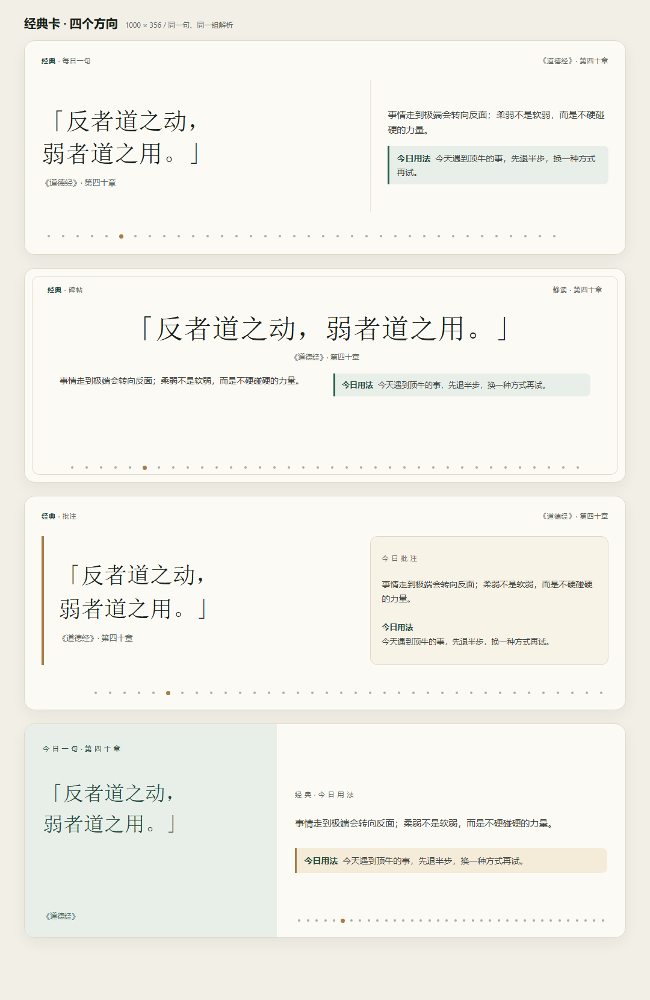

# Side Panel · 1080×1920 侧屏面板

一个给竖屏副屏用的常驻信息面板：三天月历、今日指南、备忘、经典、天气、GitHub 今日热点和一条资讯。

不是普通桌面 App：无边框、任务栏保留、左上角小圆点收起/展开；双击顶部空白切全屏。纸色、宋体、低饱和松绿和土金，适合长时间放在侧边看。



## 特性

- **侧屏常驻**：按副屏工作区放置，任务栏完整可见；没有副屏时可在主屏运行。
- **启动折叠**：登录后只显示左上 64×64 小按钮，点它才展开。
- **数据只读**：指南、天气、新闻、经典、GitHub 都由 JSON 驱动；面板不联网计算。
- **今日指南**：主卡显示当前时辰的财神/喜神/福神方位，随时辰切换；详情与主卡分开更新。
- **一页详情**：农历宜忌、十二时辰吉凶、各时辰宜忌、五维、今日可做、警示和行动时段压成一页，减少滚动。
- **经典轮换**：36 条经典从 06:00 起每 30 分钟自动切换，23:30 后停在最后一条。
- **可选占卦**：任何能输出 JSON 的 harness 都可生成并导入 `today.json`。等待当日指南时显示「未推算」。
- **本地优先**：备忘、阅读记录、缓存都在本机 `data/`，默认不进 Git。
- **Qt5 实机适配**：不依赖 flex gap；无边框、多屏、DPI 和任务栏都已在 Windows 实机验证。

## 环境

- Windows 10/11
- Python 3.10+（开发机 3.14）
- 推荐 1080×1920 竖屏副屏；单屏也能跑
- 依赖：PyQt5 5.15、PyQtWebEngine 5.15、psutil

## 五分钟跑起来

```powershell
git clone https://github.com/yyds29668-lab/side-panel.git
cd side-panel

python -m venv .venv
.\.venv\Scripts\Activate.ps1
python -m pip install -r requirements.txt

copy config.example.json config.json
python scripts\bootstrap.py
python app\qt_main.py
```

或者直接：

```powershell
powershell -ExecutionPolicy Bypass -File scripts\setup.ps1
```

启动后如果只看到左上角小圆点，点它展开。

## 配置

`config.json`（从 `config.example.json` 复制，已加入 .gitignore）：

```json
{
  "screen": "auto",
  "window": { "width": 1080, "height": null, "x": 0, "y": 0 },
  "weather": { "name": "北京", "lat": 39.9042, "lon": 116.4074 }
}
```

- `screen`：`auto` / `primary` / `secondary` / 屏幕序号（0、1）/ 屏幕名称。
- `window.width`：默认 1080；`height` 为 null 时用屏幕可用高度。
- `weather`：改成你所在城市的名称和坐标；跑一次天气采集。

## 第一次填数据

```powershell
python scripts\collect_weather.py
python scripts\collect_news.py
python scripts\collect_github.py
```

面板约 60 秒看一次缓存 mtime；也可以点指南卡右上角的刷新。没有缓存时各卡会显示等待/空态，不会崩。

备忘第一次运行会自动生成 8 条示例待办，可直接勾选、删除或添加。

## 每日指南更新：四件同步

指南更新后，天气、新闻、GitHub、经典必须在同一轮刷新：

```powershell
python scripts\import_guide.py --file today.json
powershell -ExecutionPolicy Bypass -File scripts\sync_today.ps1
```

`sync_today.ps1` 会校验 `today.json` 的 date、运行 `refresh_daily.py` 的四个采集/校验步骤，然后给运行中的页面发重载信号。

- 天气：实时 Open-Meteo，失败保留上次成功缓存。
- 新闻 / GitHub：抓取失败保留上次快照。
- 经典：`quotes.json` 校验；36 条从 06:00 起每 30 分钟轮换，23:30 后停在最后一条，次日 06:00 重置。

### 评级不默认“平”

| 等级 | 分数 |
| --- | ---: |
| 大吉 | 8.5–10 |
| 吉 | 7.0–8.4 |
| 小吉 | 6.0–6.9 |
| 平 | 4.5–5.9 |
| 小凶 | 3.0–4.4 |
| 凶 | 1.0–2.9 |
| 大凶 | 0–0.9 |

先用卦象和五维定级，再填分数。像“天地否 4.8”是平，不是系统默认；泰卦 8.4/10 就是吉。

## 占卦是可选的

当天没有 `today.json` 时，今日指南显示「未推算」。已配置本地历法数据时，卡片会同时显示当天农历宜忌。

公开源码版带公历和三日历。农历、时辰与宜忌可通过本地数据补充；缺数据时界面会明确提示。文件格式见 [数据格式](docs/DATA.md)。

任何 harness 都可以生成今日指南：

1. 让 harness 读 `docs/HARNESS.md` 的通用提示词；
2. 它按六爻/三枚硬币随机起卦，输出 `today.json`；
3. 导入：

```powershell
python scripts\harness_prompt.py > prompt.txt
# 把 prompt.txt 交给 Claude Code / Codex / Cursor / Gemini / Aider / 任何能读文件的 agent
python scripts\import_guide.py --file today.json
```

没有绑定 API、SDK 或厂商；只要是能输出 JSON 的 harness 都行。

## 开机自启（可选）

```powershell
powershell -ExecutionPolicy Bypass -File scripts\install_startup.ps1
```

任务名：`SidePanel-Startup`，登录后延迟 20 秒。

看门狗与每日维护：

```powershell
powershell -ExecutionPolicy Bypass -File scripts\install_maintenance.ps1
```

注册 `SidePanel-Watchdog`（每 3 分钟）和 `SidePanel-Maint`（每天 04:00）。

## 数据与隐私

- `data/` 全部在本机，已写入 `.gitignore`。
- 仓库只带 `data.demo/cache/quotes.json` 的公开经典条目。
- 不要提交个人指南、个人备忘、日志、备份或 `config.json`。
- 命理/占卦内容只作传统文化与自我整理参考，不构成医疗、心理、法律或投资建议。

## 目录

```text
app/            PyQt5 外壳 + 数据层
design/         1080×1920 HTML/CSS/JS 面板
scripts/        天气、资讯、GitHub、看门狗、导入指南
docs/           SETUP / DATA / HARNESS
data.demo/      公开示例数据（经典 36 条）
config.example.json
```

## 文档

- [安装与屏幕配置](docs/SETUP.md)
- [数据格式](docs/DATA.md)
- [任意 harness 占卦接入](docs/HARNESS.md)

## License

MIT。经典原文属公版；第三方新闻/仓库内容归各自来源。
